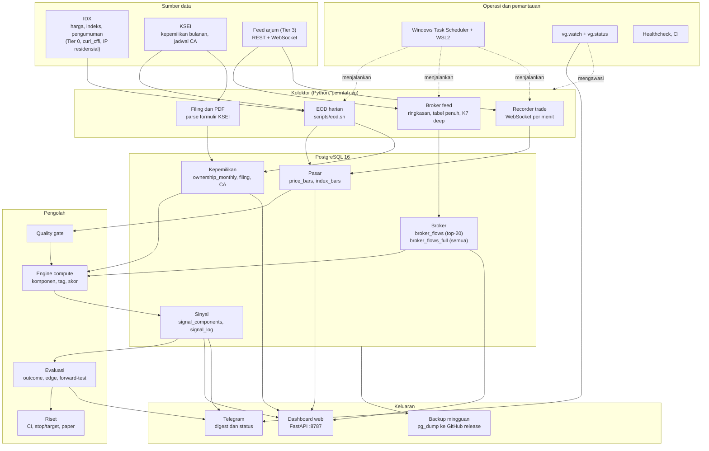
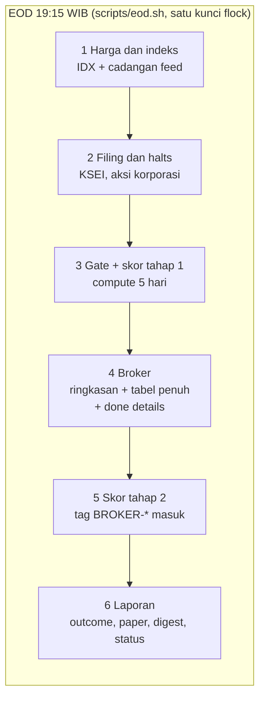
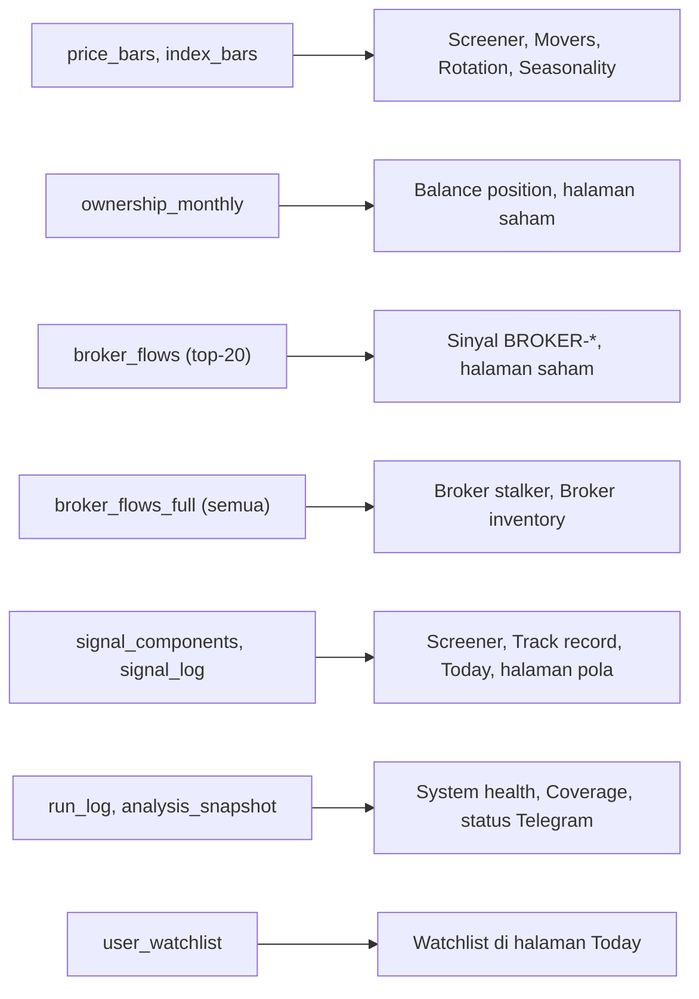

# Arsitektur Vektor Gauss

Dokumen ini adalah peta sistem: dari mana data datang, siapa yang mengumpulkan, di tabel mana disimpan, siapa yang mengolah, dan
halaman atau laporan mana yang menampilkannya. Diagram memakai Mermaid, jadi tampil langsung di GitHub dan di sebagian besar editor.

> **Dijaga oleh tes.** `tests/test_architecture_doc.py` gagal bila ada perintah `vg`, tabel database, atau halaman web yang belum
> disebut di sini. Menambah salah satunya berarti menambah barisnya di dokumen ini (lihat "Cara memperbarui" di bawah).

Dokumen lain yang lebih dalam: [README.md](README.md) (cara pakai), [ARSITEKTUR-DATA-v1.md](ARSITEKTUR-DATA-v1.md) (prinsip data),
[PRINSIP-DATA.md](PRINSIP-DATA.md), [HANDOFF.md](HANDOFF.md) (riwayat sesi), [ROADMAP.md](ROADMAP.md), [INVENTARIS-DATA-DB.md](INVENTARIS-DATA-DB.md).

## 1. Gambaran besar

Prinsip yang membentuk bentuk ini:

- **Aturan, bukan model AI.** Semua tag dan skor dihitung dengan aturan yang bisa dibaca dan diulang; tidak ada LLM di dalam sistem.
- **Forward-test.** Sinyal sebelum `VG_FORWARD_SINCE` adalah in-sample; yang sesudahnya dinilai terpisah. Kode yang menyentuh data
  sebelum tanggal itu menolak menyentuh sesudahnya (contoh: `vg backfill-wash`).
- **Idempotent.** Semua kolektor memakai upsert dan melewati data yang sudah ada, jadi menjalankan ulang aman dan tidak memakai kuota ulang.
- **Sumber bertingkat.** Tier 0 = IDX langsung, Tier 3 = feed pihak ketiga. Feed hanya melengkapi atau menjadi cadangan, tidak menimpa Tier 0.
- **Berjalan di PC rumah.** IDX memblokir semua IP cloud; WSL2 di PC rumah dengan IP residensial adalah satu-satunya tempat yang lolos.

## 2. Jadwal dan urutan kerja

| Pekerjaan | Kapan | Perintah / skrip | Catatan |
|---|---|---|---|
| EOD | 19:15 WIB, hari kerja | `scripts/eod.sh` | Task `VektorGauss-EOD`; kunci `flock` mencegah tumpang tindih |
| Kepemilikan KSEI | tiap hari, sampai file bulan lalu masuk | `vg collect-ownership --pending` (di dalam EOD) | tidak mengunduh apa pun setelah file bulan lalu tersimpan |
| Free float (LBRE) | tiap hari | `vg collect-free-float --recent 10` (di dalam EOD) | pengumuman yang sudah tersimpan dilewati; ramai hari ke-5 s/d 12 tiap bulan |
| Backfill broker dalam (K7) | 00:10 tiap malam | `scripts/deep_backfill.sh` → `vg broker-deep` | Task `VektorGauss-DeepBackfill`; terbatas budget panggilan harian (`VG_DEEP_BUDGET`) dan berjalan paralel (`VG_DEEP_WORKERS`) |
| Recorder trade | 08:55, Sen-Jum | `scripts/record_trades.sh` → `vg record-trades` | Task `VektorGauss-TradeRecorder`; melewati hari libur bursa |
| Status pagi/malam | harian | `scripts/status.sh` → `vg status` | Bisa memberi tahu bila EOD tidak jalan |
| Backup | Minggu, di dalam EOD | `scripts/backup.sh` | `pg_dump` + artefak mentah ke GitHub release |
| Dashboard | selalu hidup | `scripts/serve.sh` → `vg serve` | Port 8787; kata sandi wajib bila dibuka ke jaringan |

GitHub Actions (`.github/workflows/eod.yml`) tinggal jalur manual: runner self-hosted tidak bisa stabil di WSL2, jadi penjadwal utamanya
Windows Task Scheduler. `ci.yml` menjalankan tes dan lint.

## 3. Sumber data dan kolektor

| Sumber | Modul | Perintah `vg` | Menulis ke |
|---|---|---|---|
| IDX Stock Summary | `sources/idx.py` | `collect-price` | `price_bars`, `trading_calendar` |
| IDX Index Summary | `sources/idx.py` | `collect-index` | `index_bars` |
| IDX pengumuman (halts, filing) | `sources/trading_halt.py`, `sources/disclosure.py` | `collect-halts`, `collect-disclosure` | `trading_halts`, `disclosure_filings` |
| PDF formulir KSEI | `sources/disclosure_pdf.py` | `parse-disclosure` | `disclosure_holdings` |
| KSEI kepemilikan bulanan | `sources/ksei.py` | `collect-ownership` (`--pending` tiap hari), `ownership` | `ownership_monthly` |
| Free float riil (LBRE bulanan emiten) | `freefloat.py` (pengumuman BEI "Registrasi Pemegang Efek", PDF templat BEI) | `collect-free-float` (`--recent` tiap hari, `--backfill`) | `free_float_monthly` (dipakai `FLOAT2-ASING-PADAT`) |
| KSEI jadwal aksi korporasi | `sources/ksei.py` | `collect-corpactions`, `detect-ca` | `corp_actions` |
| Feed: riwayat harga (cadangan) | `sources/vektorgauss.py` | `collect-price-history` | `price_bars` (tidak menimpa IDX) |
| Feed: broker summary (top-20 net beli) | `sources/vektorgauss.py`, `collect.py` | `collect-broker-summary`, `broker-deep` | `broker_flows`, `broker_levels` |
| Feed: broker summary lengkap (`all_data=true`) | `brokerfull.py` | `collect-broker-full` | `broker_flows_full` |
| Feed: inventori broker | `collect.py` | `collect-broker-inventory` | `broker_inventory` |
| Feed: done details (HAKA/HAKI) | `collect.py` | `collect-done-details` | `done_by_price` |
| Feed: running trade (WebSocket) | `tradeflow.py` | `record-trades` | `trade_flow_1m`, `trade_lots_daily` (hitungan fill ≥ 50 lot per harga/ukuran/sisi untuk proxy iceberg; forward-only sejak 2026-11-07) |
| Koreksi harga | `repair.py`, `adjust.py` | `repair-prices`, `compute-adj`, `adj-report` | `adj_factor`, `price_adj` |

Dua tabel broker sengaja terpisah. `broker_flows` hanya memuat 20 broker dengan net beli terbesar per saham per hari (bawaan feed, tanpa
net seller) dan memberi makan sinyal `BROKER-*` yang sedang diuji forward, jadi isinya tidak boleh berubah. `broker_flows_full` memuat
semua broker (beli sama dengan jual) dengan harga kuota yang sama, dan hanya dibaca halaman Broker stalker dan Broker inventory. Sebuah
stock-day disimpan di sana hanya bila lengkap (beli dan jual cocok dalam 1%).

## 4. Pengolahan

| Tahap | Modul | Perintah | Hasil |
|---|---|---|---|
| Quality gate | `quality.py` | `quality-gate` | memblokir `compute` bila input hari itu rusak |
| Komponen, tag, skor | `engine/__init__.py`, `engine/scoring.py`, `broker_bounds.py` | `compute`, `backfill-wash`, `backfill-tags-v2` | `signal_components`, `signal_log`, `signal_snapshot` (tag saat PERTAMA dihitung, tidak pernah ditimpa; evaluasi forward sejak `FREEZE_SINCE` hanya menghitung tag yang tercatat sebelum 08:00 WIB hari berikutnya, lewat `engine.EVAL_SOURCE`). Tag v2 (`V2_TAGS`: KSEI2-*, FOREIGN-INST2, DOM-RETAIL2, BROKER2-DOMISILI-*, FLOAT2) jam baru: `compute` hanya memancarkannya untuk sesi ≥ `V2_TAGS_SINCE`; riwayat in-sample sebelum `VG_FORWARD_SINCE` hanya lewat `backfill-tags-v2` (INSERT saja, tidak pernah update); rentang di antaranya sengaja kosong |
| Outcome forward | `engine/__init__.py` | `backfill-outcomes` | return 1/3/5/10 hari, `market_breadth` |
| Outcome v2 | `outcomes2.py` | `backfill-outcomes2`, `eval-compare` | masuk di VWAP t+1, total return dari harga acuan `prev` IDX (split/bonus/rights, hanya bar tier 0) + dividen; `signal_log.ret2_*`, `ret2_daily` (setiap saham-hari yang tertransaksi; dipakai `market_breadth2` dan riset "Is the edge real?"), `market_breadth2` (rumus sama). v1 tidak disentuh |
| Penanda data rusak | `flags.py` | `flag-signals` (EOD) | `signal_flags`: sinyal yang input-nya diketahui rusak SAAT ITU (lompatan scripless KSEI, bulan KSEI belum terbit, jendela aksi korporasi, salinan tabel broker, bar fallback). Track record menampilkan edge dengan dan tanpa baris ini |
| Evaluasi per tag | `engine/__init__.py`, `web/edge.py` | `eval` | edge terhadap universe, hit rate |
| Paper trading | `paper.py` | `paper-update`, `paper-report` | `paper_trades` |
| Uji stop/target | `risk.py`, `risk_eval.py` | `risk-eval` | `analysis_snapshot` |
| Apakah edge nyata | `research.py` | `research` | CI sadar-ketergantungan, FDR |
| Musiman | `season.py` | `season` | statistik hari dan bulan |
| Kalkulator posisi | `calc.py` | `calc` | ukuran lot, stop, target |

## 5. Database (PostgreSQL 16)

Skema ada di `db/schema.sql` (idempoten; `vg init-db` dijalankan di awal EOD). Tabel dan pembacanya:

| Kelompok | Tabel |
|---|---|
| Kalender dan daftar | `trading_calendar`, `tickers` |
| Pasar | `price_bars`, `index_bars`, `adj_factor`, `price_adj`, `market_breadth`, `market_breadth2`, `ret2_daily` |
| Kepemilikan dan filing | `ownership_monthly`, `free_float_monthly`, `corp_actions`, `disclosure_filings`, `disclosure_holdings`, `trading_halts` |
| Broker | `broker_flows`, `broker_levels`, `broker_flows_full`, `broker_inventory`, `done_by_price`, `broker_affiliation_groups` |
| Aliran trade | `trade_flow_1m`, `trade_lots_daily` |
| Sinyal | `signal_components`, `signal_log`, `signal_snapshot`, `signal_flags`, `paper_trades` |
| Operasional | `run_log`, `raw_artifacts`, `analysis_snapshot`, `user_watchlist` |

`raw_artifacts` mencatat sha256 setiap respons mentah yang diarsipkan di `data/artifacts`, supaya baris yang salah parse bisa diparse ulang.
Respons `all_data` tidak diarsipkan (sekitar empat kali lebih besar); baris terparsenya yang disimpan.

## 6. Keluaran

### Dashboard web (FastAPI + Jinja2, `src/vg/web/`)

| Halaman | Rute | Modul / tabel utama |
|---|---|---|
| Screener | `/`, `/screener` | `home.py`, `listing.py`, `live_scores.py`, `bpi_window.py` (BPI 5 sesi dari ladder `broker_levels` yang dijumlahkan, read-only, bukan tag); sinyal dan harga |
| Today | `/today`, `/watchlist/add`, `/watchlist/remove` | `today.py`, `watchlist.py`; `user_watchlist` |
| Top movers | `/movers` | `movers.py`; `price_bars` |
| Top rankings | `/ranking` | `listing.py` |
| Sector rotation | `/rotation` | `rotation.py` |
| Track record | `/track-record`, `/eval` | `edge.py`, `status.py`; `signal_log` |
| Stop dan target | `/risk-test` | `risk_eval.py` |
| Apakah edge nyata | `/research` | `research.py` |
| Halaman pola | `/pattern/{tag}` | `pattern.py` |
| Halaman saham | `/stock/{ticker}`, `/search` | `stock.py`, `charts.py` |
| Balance position | `/balance` | `balance.py`; `ownership_monthly` |
| Seasonality | `/seasonality` | `seasonal.py`, `season.py` |
| Broker stalker | `/stalker` | `stalker.py`; `broker_flows_full` |
| Broker inventory | `/inventory` | `inventory.py`; `broker_flows_full` |
| System health | `/health`, `/system` | `status.py`, `watch.py`, `runlog.py` |
| Coverage | `/coverage`, `/coverage/missing` | `coverage.py` |
| Panduan | `/guide` | `glossary.py` |
| Cek hidup | `/healthz` | untuk `vg.status` dan penjadwal |

Semua grafik adalah SVG dari server (`charts.py`), tanpa JavaScript dan tanpa pustaka grafik. Autentikasi HTTP Basic aktif bila server
dibuka ke jaringan (`auth.py`); formulir mengecek Origin sebagai pertahanan CSRF.

### Telegram dan pemantauan

- `digest.py` dan `telegram.py`: ringkasan EOD harian dan evaluasi mingguan; bagian WATCHLIST mengikuti daftar yang Anda isi di halaman Today.
- `status.py` dan `watch.py`: pemeriksaan "apakah sistem benar-benar berjalan": kesegaran data, kegagalan koleksi, tiap koleksi harian
  sudah jalan, recorder per sesi, kuota feed, K7, backup, disk. Dikirim ke Telegram dan tampil di System health.
- `reminder.py` (`vg remind-verify`): pengingat verifikasi satu kali setelah compute pertama yang sehat.
- `checkpoint_reminder.py` (`vg remind-checkpoint`): Telegram harian di akhir EOD, sekali per sesi — cek otomatis (cakupan broker, `trade_lots_daily`, `signal_snapshot`, tag v2) + item terbuka dari `CHECKPOINT.md`.
- `audit.py` (`vg audit-data`): audit integritas data (read-only, dari audit 2026-11-07): hari aksi korporasi yang belum disesuaikan
  (dideteksi dari harga acuan `prev` IDX), "split" yang tidak dihargai BEI, kolom free float, lompatan basis scripless KSEI, salinan tabel
  broker, kesegaran `adj_factor`, return 5 hari ekstrem, kewajaran bar harga, ukuran broker sepihak. Exit 1 bila ada temuan BAD.

## 6b. Konfigurasi

`config.py` (pydantic-settings) membaca `.env` dengan awalan `VG_*`; contohnya ada di `.env.example`. Kunci yang paling menentukan:
`VG_DATABASE_URL`, `VG_FEED_BASE_URL` / `VG_FEED_API_KEY`, `VG_FORWARD_SINCE`, `VG_WATCHLIST` (daftar untuk koleksi, bukan watchlist
dashboard), `VG_WEB_PASSWORD`, `VG_DEEP_BUDGET`, `VG_DEEP_WORKERS` (panggilan feed paralel untuk K7, maks 8), `VG_FEED_DELAY_SECONDS`.

## 7. Cara memperbarui dokumen ini

Perbarui bagian yang bersangkutan dalam commit yang sama dengan perubahannya:

| Bila Anda menambah... | Ubah bagian |
|---|---|
| perintah `vg` baru | 3 atau 4, dan 2 bila terjadwal |
| tabel atau migrasi skema | 5 (kelompok tabel dan diagram bila ada pembaca baru) |
| halaman atau rute web | 6 |
| sumber data atau kolektor | 1 (diagram), 3 |
| pekerjaan terjadwal | 2 |

`pytest tests/test_architecture_doc.py` memeriksa bahwa setiap perintah, tabel, dan rute tersebut disebut di dokumen ini.
