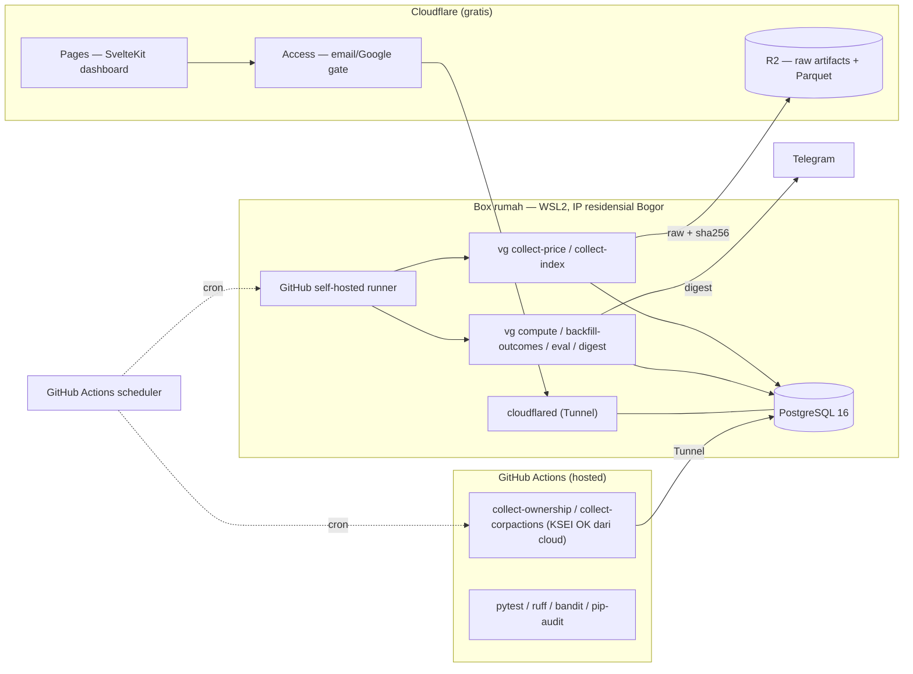
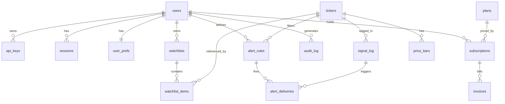

# Rencana Fase 2 — Konsep Produk, Data, Infrastruktur & Arsitektur

Pendamping: [RENCANA-FASE-1.md](RENCANA-FASE-1.md) · [PRINSIP-DATA.md](PRINSIP-DATA.md) *(mengikat)* ·
[INVENTARIS-SUMBER-DATA.md](INVENTARIS-SUMBER-DATA.md) · [LANSKAP-KOMPETITOR.md](LANSKAP-KOMPETITOR.md) ·
[IDXALPHA-TEARDOWN.md](IDXALPHA-TEARDOWN.md) · [SECTORS-API.md](SECTORS-API.md) · [HANDOFF.md](HANDOFF.md).

> **Status:** dokumen desain. **Belum ada kode Fase 2 yang dikerjakan.** Ini "blueprint
> dulu, build nanti" — desain lengkap yang **ditahan** sampai gate di §10 lolos.

---

## Context

Vektor Gauss hari ini = alat pribadi: paket Python `vg` (`src/vg` — collector IDX/KSEI,
engine sinyal 2-lapis, kalkulator posisi `calc`, digest Telegram), PostgreSQL 16, cron
EOD 19:15 WIB di WSL2 rumah. `main` @ `453a0f4`, pytest 59/59. Tidak ada lapisan web.

Dokumen ini mendefinisikan, sebagai perencana produk + solution architect:
1. Konsep produk & logika bisnis aplikasi bandarmologi (bentuk, alur, fungsi, fitur).
2. Blueprint arsitektur software (tech stack, struktur folder, skema DB, auth & keamanan).
3. Inventaris sumber data di dalam ekosistem aplikasi.
4. Infrastruktur dengan **GitHub + Cloudflare** (biaya ~$0); **VPS disiapkan konsepnya
   dulu, provisioning belakangan**.

### Keputusan yang mengunci dokumen ini (2026-09-03)
- **"Blueprint dulu, build nanti."** Desain SaaS lengkap, ditahan sampai gate lolos.
- **Target: diri sendiri dulu, produk belakangan.** Fitur multi-user/billing = opsi
  Fase 2, bukan komitmen.
- **Positioning: jujur / evidence-graded.** Nilai jual = transparansi + rapor
  forward-test tiap tag (termasuk yang GAGAL). Alpha bukan janji utama.
- **Frontend: SvelteKit** (alasan di §5). **Payments: adapter kosong**, diputus Fase 2.

### Realita pasar yang membentuk konsep ([LANSKAP-KOMPETITOR.md](LANSKAP-KOMPETITOR.md))
- **VERDICT riset:** IDX foreign-flow gratis + KSEI bulanan = **belum ada edge tradeable**
  (3,5 th, 9 tag, ~600k obs). Tidak ada tag lolos biaya ~150–190 bp.
- **IDXAlpha sudah membangun konsep ini, gratis, metodologi terbuka** — dan mengakui IC
  komponennya 0,02–0,09 vs break-even ~0,19 → skor komposit tak terbukti beredge setelah
  biaya.
- Pricing power ≈ 0 (NeoBDM Rp35k, Terminal B Rp21–129k, IDXAlpha gratis, IDXRadar Rp50k).
  Tidak ada data moat — semua pakai IDX EOD + KSEI yang sama.
- **Konsekuensi:** produk "platform bandarmologi #8" tidak masuk akal. Satu-satunya sudut
  jujur = **rapor bukti + transparansi radikal**, atau pivot ke B2B/API. Fase 1 tetap
  alat pribadi; produk hanya jika forward-test menemukan sesuatu yang nyata.

---

## 1. Konsep Produk & Logika Bisnis

### 1.1 Definisi produk & janji
**Vektor Gauss = instrumen bandarmologi yang diberi nilai berdasarkan bukti.** Ia membaca
data aliran modal resmi IDX/KSEI (dan nanti broker summary berlisensi), memberi *tag
deskriptif* pola akumulasi/distribusi/markup, lalu — yang membedakan — **menyimpan rapor
permanen apakah tiap tag benar-benar mendahului pergerakan harga.**

Janji produk **bukan** "kami menemukan bandar." Janji-nya: *"inilah yang dikatakan data
aliran, dan inilah rekam jejak jujur dari klaim itu — termasuk saat ia meleset."*

Kontras kompetitor: NeoBDM/IDXAlpha menjual skor & label pelaku (Sultan/Zombie); Smart
Money Flow menjual klaim backtest marketing-y. Vektor Gauss menjual **metodologi yang
bisa diaudit**.

### 1.2 Logika bisnis (metodologi — sudah ada di `engine.py`, dikonsolidasi)

**A. Sistem 2 lapis.**
- **Probation (bobot 0):** semua tag baru. Dihitung, ditampilkan, di-forward-test —
  **tak pernah** menggerakkan aksi/alert. Hari-1 semua tag di sini.
- **Weighted (bobot > 0):** tag yang sudah membuktikan edge forward. Baru boleh memicu
  alert aksi.
- **Promosi:** forward n≥50, ≥2 bulan, edge vs universe equal-weight searah in-sample,
  lolos biaya ~150–190 bp. **Demosi:** edge forward meluruh → turun lagi ke probation.
- Belum ada kode 'weighted' (`engine.py:525` menulis `'probation'` hardcoded). Promosi =
  tambahan kecil saat data membenarkan.

**B. Forward-test = fitur inti, bukan catatan kaki.** Tiap emisi tag dicatat + close-nya
(`signal_log`); outcome H+1/3/5/10 & vs-universe di-backfill; `vg eval` menghasilkan
rapor. **Rapor ini permukaan produk kelas satu**, bukan modul tersembunyi.

**C. Gerbang integritas data sebelum tag apa pun** ([PRINSIP-DATA.md](PRINSIP-DATA.md)
Part C, 9 cek): RG dipisah dari NG (flow di reguler saja; NG tinggi → `CROSSING-TINGGI`);
penyesuaian corporate action wajib; emiten suspend/volume-0 dikeluarkan; validasi silang
bulanan (arah flow harus searah Δ%asing KSEI, kalau tidak → `KSEI-DIVERGEN`); (Fase 1.5)
rekonsiliasi `Σ broker value ≈ IDX Value`, deteksi wash-trade, netting broker terafiliasi.
Baris `RECON_FAIL` → tidak menghasilkan tag hari itu.

**D. Doktrin "un-paintable"** ([PRINSIP-DATA.md](PRINSIP-DATA.md) Part B): utamakan sinyal
yang bandar tak bisa palsukan — flag domisili-asing resmi IDX, perubahan register KSEI,
perubahan jumlah pemegang saham, konsistensi net-foreign multi-minggu. Turunkan prioritas
sinyal inferensi (maker/taker/CVD — validasi IDXAlpha sendiri r=−0,404), heuristik
"Sultan/Zombie" (butuh data order-size yang tidak ada).

**E. Tanpa skor komposit 0–100.** Sengaja. IDXAlpha punya, dan mengakui tak beredge
setelah biaya. Rapor per-tag lebih jujur daripada satu angka.

**F. Matematika posisi mekanis, bukan saran arah.** `calc.plan()`: user beri entry/SL
(atau SL turunan ATR) → sistem hitung lot & R:R. Kalau dijual: tanpa verb "BUY/SELL"
(OJK, [RENCANA-FASE-1.md](RENCANA-FASE-1.md) §11).

### 1.3 Daftar fitur (bertingkat)

| Fitur | Status | Fase |
|---|---|---|
| Collector IDX Stock/Index Summary, KSEI ownership + CA | ✅ ada | 1 |
| Engine 2-lapis + 12 tag probation | ✅ ada | 1 |
| `vg eval` rapor edge vs universe (+ subset likuid) | ✅ ada | 1 |
| Digest Telegram EOD + eval mingguan | ✅ ada | 1 |
| Kalkulator posisi `vg calc` | ✅ ada | 1 |
| Seasonality, riwayat ownership | ✅ ada | 1 |
| **`vg eval --since` (forward-only)** — pembeda in-sample vs forward | ⬜ GAP | 1 (kritis untuk gate) |
| **RADAR di-refocus** ke kandidat hidup (kini hardcoded ke `AKUM-ASING` mati) | ⬜ GAP | 1 |
| **Dashboard web read-only** (rapor + watchlist) di Cloudflare Pages | ⬜ | 1→2 (prasyarat produk) |
| Collector >5%/insider harian + tag `LAPOR-KEPEMILIKAN-RAMAI` (probation) | ◑ Fase A jalan | 1.5 |
| Parser form PDF KSEI → `disclosure_holdings` + tag `INSIDER-AKUM/DIST`, `SUBSTANTIAL-*` | ⬜ | 1.5 (Fase B) |
| `BrokerSummarySource` adapter (Sectors $59 / Index Alpha Rp200k) | ⬜ stub skema ada | 1.5 |
| Tag broker-level: CR3/konsentrasi, cohort institusi-vs-ritel, inventory bandar, wash-detect | ⬜ | 1.5 |
| Multi-user, tier, watchlist per-user, alert rules | ⬜ | 2 (gated) |
| Billing (Midtrans/Xendit) | ⬜ adapter kosong | 2 (gated) |
| API akses (sudut B2B) | ⬜ | 2 (gated) |
| Rapor publik sebagai pembeda ("lihat rekam jejak sebelum bayar") | ⬜ | 2 (gated) |

### 1.4 Alur pengguna (Fase 2, kalau jadi)
- **Anonim** → landing → **halaman Rapor publik** (edge forward tiap tag, terbuka) →
  daftar (email + password, Turnstile) → verifikasi email → tier `free`.
- **Free:** watchlist ≤5, sinyal delay 1 hari, rapor penuh, kalkulator.
- **Upgrade** (Midtrans/Xendit) → `pro`: sinyal H+0, RADAR, alert rules (email/Telegram/
  webhook), API key.
- **Harian:** buka dashboard → watchlist (harga, NFF D0/W1, konsistensi asing, quadrant,
  tag, flag ⚠) → klik ticker → detail + rapor tag itu + kalkulator (user isi entry/SL).
- **Alert** hanya untuk tag lapis **weighted**; probation tak pernah memicu.

### 1.5 Monetisasi (kalau jadi — kecil, bukan rencana bisnis)
Freemium. Pricing power ≈ 0 → target realistis Rp0 (free, rapor + delay) dan satu tier
berbayar tipis (Rp25–50k: H+0 + alert + API). Sudut yang lebih masuk akal: **API B2B**
untuk komunitas trading / white-label, atau tetap alat internal. Keputusan monetisasi =
setelah gate.

---

## 2. Inventaris Sumber Data (ekosistem aplikasi)

Semua di balik **adapter** (`PriceSource`, `OwnershipSource`, `BrokerSummarySource` —
stub). Tiap baris data punya kolom `source` + `source_tier`. Simpan raw artifact + SHA256
tiap hari (`raw_artifacts`).

### 2.1 Tier 0 — resmi, gratis, publik (dipakai Fase 1)

| Sumber | Field | Endpoint | Frekuensi | Catatan reliabilitas |
|---|---|---|---|---|
| **IDX Stock Summary** | OHLCV, `ForeignBuy`/`ForeignSell` (volume/lembar), `NonRegular{Volume,Value,Freq}`, `ListedShares`, `TradebleShares`, Bid/Offer, Remarks | `www.idx.co.id/primary/TradingSummary/GetStockSummary?length=9999&start=0&date=YYYYMMDD` (tanpa `date` = terbaru), ~963 baris | EOD ~17–19 WIB | **Cloudflare** di depan — blokir SEMUA ASN cloud (HTTP 1020). Hanya jalan dari **IP residensial Indonesia** + `curl_cffi` (impersonasi Chrome + prime cookie `__cf_bm`). **UNVERIFIED:** `ForeignBuy/Sell` all-board vs regular-only. |
| **IDX Index Summary** | close ~45 indeks/hari, `COMPOSITE` = IHSG | `.../TradingSummary/GetIndexSummary?...` | EOD | idem (Cloudflare) |
| **KSEI Kepemilikan (Lokal-Asing)** | 9 kategori investor × lokal/asing (asuransi, korporat, dapen, lembaga keu., individu, reksadana, sekuritas, yayasan, lainnya), nilai = jumlah lembar; scripless % | `web.ksei.co.id/Download/BalanceposEfek<YYYYMMDD>.zip` (YYYYMMDD = hari bursa terakhir bulan; geser utk libur) → ZIP → 1 `.txt` pipe-delimited 25 kolom, filter Type=EQUITY (~1000 baris) | **BULANAN** (akhir bulan) | KSEI **tanpa Cloudflare** — jalan dari mana saja. File ~2018+. **Tidak ada jumlah pemegang saham** di file ini. Tanggal file bergeser utk libur → collector coba weekday terakhir, mundur ≤9 hari. |
| **KSEI List of CA Activities** | tanggal, jenis, rasio (dividen, HMETD, bonus, merger) | `web.ksei.co.id/Download/schedule_ca_keseluruhan_<YEAR>.xls` (tabel HTML 15 kolom) + file per-tipe (`div_`, `Bonu_`, `right_`, …) | Mingguan cek | **Tanpa stock split** — split dideteksi dari lonjakan `listed_shares` (`vg detect-ca`). `mconv_*` = konversi obligasi, bukan split. |
| **>5% / insider ownership** (POJK 4/2024) | filing per emiten: pihak pelapor, jabatan (direksi/komisaris), saham & % sebelum/sesudah, jenis transaksi, harga, tanggal | IDX `GetAnnouncement` (`keyword=LAPORAN KEPEMILIKAN`) → form PDF KSEI standar | ~harian (~13/hari bursa) | **Fase A jalan** (`vg collect-disclosure` — metadata + arsip PDF + tag `LAPOR-KEPEMILIKAN-RAMAI`). Fase B = parse PDF → tag `INSIDER-*`/`SUBSTANTIAL-*`. Dasar produk IDXRadar. Cloudflare → runner residensial. |
| **Kalender bursa** | tanggal unik dari Stock Summary | turunan | otomatis | window sinyal = hari bursa (row-based), bukan kalender. |

### 2.2 Tier 1/2 — berlisensi / berbayar (Fase 1.5, kalau gate gagal atau butuh kedalaman)

| Vendor | Yang diberi | Harga | Kedalaman sejarah | Catatan |
|---|---|---|---|---|
| **Broker summary via redistributor IDX** (RTI Infokom, IQ Plus Prima, IDX-STI, Antara/IMQ) | broker summary per emiten (buy/sell per broker, flag D/F) — **inti bandarmologi** | tabel fee KOSONG → hubungi | penuh | Tier 1 = setara Tier 0. Wajib License Agreement + laporan pemakaian ke IDX. Redistribusi butuh izin Display + Redistributor. |
| **Index Alpha** (`indexalpha.id`) | broker summary + foreign flow, API/CSV/Excel | Free 5 tkr/hari · **Starter Rp200k** (25k req) · Pro Rp350k · Advanced Rp750k | **hanya sejak 2025-01-01** (~1,5 th — backfill pendek) | operator kecil (`@neon_scale`), kemungkinan scraper sendiri → risiko ToS berlapis. Kamu tetap parse KSEI sendiri. |
| **Sectors.app** (Supertype, SG) | broker summary `/v2/broker-summary/{sym}/top/` **dengan `cohort` (institutional/retail/mixed) + `origin` (domestic/foreign) bawaan**; `shareholders-composition` KSEI **terstruktur** per kategori L/F + **`numbers_of_shareholders` + `change_in_shareholders`** (sinyal un-paintable!) sejak 2021; `corporate-actions` per emiten; foreign flow **dalam IDR** (vs IDX-gratis = volume); indeks sejak 2019; laporan keuangan | **Insider $59/mo** (~Rp950k, 5.000 kredit/bln — pemakaian pribadi <2.000) atau $531/th | broker-level **belum dikonfirmasi** (contoh doc semua Mei 2025); ownership 2021, indeks 2019 | **Opsi Fase 1.5/2 terkuat** — 1 langganan mengganti 3 parser (broker + KSEI ownership + CA). Vendor matang, ToS komersial eksplisit. Konfirmasi: kedalaman sejarah broker-level, hak redistribusi turunan. |

### 2.3 Tidak tersedia dengan harga berapa pun
- **KSEI agregat custody harian/T+2 per emiten per tipe investor** → "audit wash-sale T+2"
  (Pilar 4 blueprint Gemini) **tidak bisa dibangun**. Hanya bulanan + gerak >5%/insider
  harian.
- **Data order-size / frekuensi** → tag "Sultan/Zombie", "Freq Analyzer" tidak reproducible
  dari data EOD (kode broker disembunyikan intraday sejak 2021).

### 2.4 Yang harus dikonfirmasi sebelum Fase 1.5
KSEI: adakah yang lebih sering dari bulanan (ORCHiD / permintaan resmi / berbayar)?
IDX: apakah "IDX Equity EoD Recapitulation" = broker summary per emiten + harganya?
`ForeignBuy/Sell` cakupan papan? Vendor: kedalaman sejarah broker-level + hak redistribusi
turunan untuk pelanggan berbayar? (Pertanyaan lengkap: [PERTANYAAN-IDX-KSEI.md](PERTANYAAN-IDX-KSEI.md).)

---

## 3. Infrastruktur — GitHub + Cloudflare (biaya ~$0), VPS ditunda

### 3.1 Kendala keras yang membentuk semuanya
- **IDX mem-block SEMUA ASN cloud/datacenter** (AWS SG + Jakarta, Oracle SG — semua HTTP
  1020, tak terpecahkan; Playwright headless pun gagal). → **collector IDX WAJIB dari IP
  residensial Indonesia.** GitHub Actions hosted runner (IP Azure) = **terblok untuk IDX**.
  Cloudflare Workers (ASN Cloudflare) = **terblok untuk IDX**.
- **KSEI jalan dari mana saja** (tanpa Cloudflare). → koleksi KSEI + engine + digest + CI
  boleh di cloud gratis.

Jadi split-nya lebih halus dari "collector vs sisanya": **hanya fetch IDX** yang terkunci
ke node residensial. Semua komputasi lain (yang cuma sentuh DB) bebas.

### 3.2 GitHub — orkestrasi, CI, sebagian compute (gratis)
- **Self-hosted Actions runner di box rumah (WSL2)** → job `collect-price` /
  `collect-index` pakai `runs-on: self-hosted`. Menggantikan Task Scheduler yang rapuh
  ([HANDOFF.md](HANDOFF.md) gotcha: `nohup` mati saat sesi WSL tutup) dengan **scheduler +
  log + retry + secrets GitHub**.
- **Hosted runner (`ubuntu-latest`)** untuk job yang tak sentuh IDX: `collect-ownership`,
  `collect-corpactions`, `compute`, `backfill-outcomes`, `eval`, `digest`, `pytest`,
  migrasi Alembic. (Butuh jalur DB — lihat Tunnel §3.3.)
- **Workflow:**
  - `eod.yml` — cron harian 12:15 UTC (19:15 WIB): step IDX di self-hosted → step
    compute/backfill/digest di self-hosted juga (sederhana) atau hosted via Tunnel.
  - `monthly.yml` — hari ≤5: `collect-ownership` + `collect-corpactions` (hosted, KSEI OK).
  - `weekly.yml` — Senin: `digest --weekly`.
  - `ci.yml` — push/PR: `pytest` + `ruff` + `bandit` + `pip-audit`.
- **Secrets:** GitHub Actions secrets (DB URL, Telegram token, UA) — bukan `.env` di disk.
- **Penyimpanan sejarah/artifact:** raw KSEI/IDX + snapshot Parquet → **Cloudflare R2**
  (§3.3), bukan di-commit ke git. GHCR untuk image kalau nanti containerize.
- **GitHub Pages** bisa host dashboard statis (pre-render tiap malam) untuk fase pribadi
  — nol infra — tapi Cloudflare Pages + Access lebih baik (auth gratis).

### 3.3 Cloudflare — jaringan, web, auth, storage (gratis/murah)
- **Cloudflare Tunnel (`cloudflared`)** — ekspos Postgres rumah (atau FastAPI read-only
  tipis di rumah) ke internet **tanpa buka port / IP statis**. User sudah punya
  `cloudflared` di satu box. Jalur bersih agar hosted runner GitHub & dashboard Cloudflare
  menjangkau data yang dikoleksi di rumah.
- **Cloudflare Pages** — host frontend **SvelteKit** (gratis, CDN global, kuota longgar).
- **Cloudflare Access (Zero Trust)** — taruh dashboard pribadi di belakang Access (email
  OTP / Google) — **auth tanpa satu baris kode** untuk fase pribadi. Solusi "Autentikasi"
  sebelum ada tabel `users`.
- **Cloudflare R2** — object storage S3-compatible, tanpa biaya egress: arsip raw artifact
  (ZIP KSEI, JSON IDX) + snapshot Parquet sejarah.
- **Cloudflare D1** (SQLite) — *nanti*: salinan "serving set" (N hari sinyal terakhir +
  rapor eval) yang diekspor tiap malam dari Postgres, supaya Workers API baca murah di
  edge. Data ini kecil → cocok D1.
- **Cloudflare Workers** — *Fase 2*: lapisan API. Workers tak bisa jangkau IDX (tak masalah
  — API cuma baca DB/D1). Workers→Postgres butuh Hyperdrive; atau API tetap FastAPI di
  rumah/VPS di belakang Tunnel.
- **Cloudflare Turnstile** — *Fase 2*: anti-bot signup (pengganti CAPTCHA).
- **Cloudflare Cron Triggers** — pemicu terjadwal untuk bit non-IDX kalau tak mau GitHub
  Actions.

### 3.4 Topologi SEKARANG (fase pribadi, ~$0)



### 3.5 Konsep VPS (disiapkan sekarang, provisioning setelah semua siap)

**Pemicu migrasi:** (a) gate lolos → produk perlu uptime lebih baik; **atau** (b) box
rumah terbukti tak cukup andal (PC sering mati, WSL sesi tutup); **atau** (c) mulai Fase
1.5 (beban naik).

**Provider (wajib IP ISP Indonesia residensial-class — datacenter IP kena 1020):**
Biznet Gio · IDCloudHost · Dewaweb · Niagahoster. ~Rp50–150k/bln.

**Spek:** 1–2 vCPU, 2 GB RAM, 20–40 GB SSD. Beban = 1 fetch/hari + Postgres kecil + 1
pesan Telegram. Nyaris idle.

**Runbook migrasi (nol perubahan kode — skema Postgres-dari-awal untuk ini):**
1. `scripts/check_idx_access.sh` dari VPS dulu — pastikan IDX 200 (bukan 1020).
2. Install toolchain, `git clone`, `uv pip install -e ".[dev]"`, `pytest`.
3. `pg_dump` dari WSL → `pg_restore` di VPS.
4. Pindah `.env` / secrets; pindah GitHub self-hosted runner ke VPS; pindah `cloudflared`
   Tunnel; pindah cron (Task Scheduler → `cron` sistem / systemd timer).
5. Box rumah → **warm standby** (bisa ambil alih kalau VPS mati).

**Kenapa ditunda:** $0 sekarang cukup untuk forward-test 2 bulan; membayar VPS untuk ide
yang belum terbukti = bakar uang (pola yang sama dengan menunda Sectors $59).

---

## 4. Struktur Folder (monorepo — saat gate lolos)

```
vektor-gauss/
├── packages/
│   └── vg-core/                 # eks-src/vg — engine, sources, calc, season, config, db
│       ├── vg/                  # import tetap `from vg...`
│       └── pyproject.toml
├── apps/
│   ├── api/                     # FastAPI
│   │   └── vg_api/
│   │       ├── main.py          # app factory, middleware, CORS, rate-limit, CSP
│   │       ├── deps.py          # get_db, get_current_user, require_plan(), require_role()
│   │       ├── routers/         # auth, signals, tickers, watchlist, calc, billing, admin, me
│   │       ├── schemas/         # pydantic request/response
│   │       ├── services/        # query di atas vg-core + Postgres (enforce plan)
│   │       ├── auth/            # fastapi-users, jwt, refresh, api-key
│   │       └── billing/         # PaymentGateway port + webhook handler
│   ├── web/                     # SvelteKit  (kalau all-Python: hapus, Jinja di apps/api)
│   │   └── src/
│   │       ├── routes/          # dashboard, ticker/[code], calc, account, billing, auth
│   │       └── lib/{api,components,stores}/   # api client di-generate dari OpenAPI
│   └── worker/                  # RQ worker: alerts, webhook, digest fan-out
├── collector/                   # tipis — wrapper cron memanggil vg-core (node residensial)
│   └── eod.sh  backfill.sh
├── db/migrations/               # Alembic
├── infra/
│   ├── docker-compose.yml            # dev: postgres + redis + api + web + worker
│   ├── docker-compose.collector.yml
│   ├── Caddyfile                     # TLS
│   ├── cloudflared/                  # config Tunnel
│   └── .github/workflows/            # eod, monthly, weekly, ci
├── docs/
│   └── RENCANA-FASE-1.md  RENCANA-FASE-2.md  PRINSIP-DATA.md  HANDOFF.md  …
└── pyproject.toml               # workspace root (uv / pdm)
```

---

## 5. Tech Stack (Fase 2)

| Lapisan | Pilihan | Alasan |
|---|---|---|
| **API** | **FastAPI** (Python 3.12) + uvicorn/gunicorn | meng-import `vg-core` langsung (1 bahasa dengan engine), async, OpenAPI + validasi Pydantic gratis, deploy ringan. API = **read-mostly** (query `signal_log`/`signal_components`/`market_breadth` → JSON); write hanya user settings, watchlist, billing webhook. Batch EOD **tak berubah**. |
| **Worker async** | **RQ** + Redis | kirim alert, proses webhook, fan-out digest. Lebih sederhana dari Celery, cukup. |
| **Scheduler batch** | **cron OS / GitHub Actions** (tak berubah) | terbukti. APScheduler in-process hanya bila butuh intraday. |
| **Frontend** | **SvelteKit** | produk = dashboard (tabel, chart flow, form kalkulator), bukan app besar. SSR bawaan, bundle terkecil, boilerplate minim → paling pas solo dev. Bisa merangkap BFF (guard di `hooks.server.ts`). Chart: **uPlot** / **Layercake** (ringan). **Alternatif:** Next.js kalau nanti hiring React dev; **FastAPI+Jinja+HTMX+Alpine** kalau mau nol build-step JS untuk v1. |
| **Database** | **PostgreSQL 16 + TimescaleDB** | sudah ada; image timescale sudah dipakai. Hypertable per `session_date` pada `price_bars`/`index_bars`. |
| **Cache/queue/session** | **Redis** | multi-guna. |
| **Auth** | **FastAPI-Users** + Argon2id + JWT (15 mnt) + refresh (opaque, Redis) | self-host, tanpa vendor. Fase pribadi: **Cloudflare Access** (tanpa kode). |
| **Migrations** | **Alembic** | ganti `schema.sql` idempoten tangan; revision #0001 di-autogenerate dari skema sekarang. |
| **Pembayaran** | **adapter kosong** → Midtrans/Xendit | pasar ID (IDR, QRIS, GoPay/OVO, VA bank). Stripe kecil kemungkinan. Diputus Fase 2. |
| **Reverse proxy/TLS** | **Caddy** (auto-HTTPS) atau Cloudflare di depan | sederhana. |

**Catatan:** `vg-core` `Config.load()` sekarang jalan saat import (`config.py:70`) —
jadikan **lazy** agar `apps/api` bisa import tanpa side-effect DB.

---

## 6. Skema Database

### 6.1 Tabel Fase 1 (sudah ada — TIDAK berubah)
`trading_calendar, tickers, price_bars, index_bars, ownership_monthly, corp_actions,
signal_components, signal_log, market_breadth, raw_artifacts, run_log,
broker_affiliation_groups` (+ `broker_flows` stub).

Domain **market-data**: keyed `(session_date, …)` / bulan, **tanpa `user_id`**, dibaca
semua user lewat service layer yang meng-enforce plan.

### 6.2 Tabel baru Fase 2 (domain **tenant** — semua ber-`user_id`)

```
users(id PK uuid, email UNIQUE, password_hash, display_name,
      role DEFAULT 'user',              -- user | admin
      plan DEFAULT 'free',              -- free | starter | pro  (denorm dari subscription aktif)
      is_active, is_verified, created_at, last_login_at,
      pdp_consent_at, deleted_at)        -- soft-delete untuk UU PDP

api_keys(id PK, user_id FK→users, key_hash UNIQUE, label, scopes[],
         last_used_at, expires_at, revoked_at, created_at)
sessions(id PK, user_id FK→users, refresh_token_hash, user_agent, ip,
         expires_at, revoked_at, created_at)     -- token live di Redis; tabel = audit

watchlists(id PK, user_id FK→users, name, is_default, created_at)
watchlist_items(watchlist_id FK→watchlists, ticker FK→tickers,
                holding_qty DEFAULT 0,           -- >0 → 📌 held  (setara VG_HOLDINGS)
                added_at, PK(watchlist_id, ticker))

alert_rules(id PK, user_id FK→users, ticker FK→tickers NULL,   -- NULL = semua
            tag, channel DEFAULT 'email',        -- email | telegram | webhook
            channel_target, is_active, created_at)
alert_deliveries(id PK, alert_rule_id FK→alert_rules,
                 signal_session_date, signal_ticker, signal_tag,
                 sent_at, status, error)

plans(code PK, name, price_idr, interval, features jsonb, is_public)
subscriptions(id PK, user_id FK→users, plan_code FK→plans, status,   -- trialing|active|past_due|canceled
              current_period_start, current_period_end, gateway, gateway_ref, cancel_at, created_at)
invoices(id PK, subscription_id FK→subscriptions, amount_idr, status, -- draft|open|paid|void
         gateway_ref, issued_at, paid_at, pdf_path)
payment_events(id PK, gateway, event_type, payload jsonb, received_at, processed_at)  -- idempotency

user_prefs(user_id PK FK→users, timezone DEFAULT 'Asia/Jakarta',
           account_balance_idr DEFAULT 0, risk_pct DEFAULT 1.0,   -- feed calc.plan()
           atr_sl_mult DEFAULT 2.0, target_r DEFAULT 2.5,
           digest_trade_calls DEFAULT false)     -- default OFF di produk (OJK)

audit_log(id PK, user_id FK→users NULL, action, entity, entity_id,
          ip, user_agent, meta jsonb, at)        -- login, gagal-login, billing, export, delete, admin
```

### 6.3 Relasi



Pemisahan tegas: market-data tanpa `user_id`; tenant selalu ber-`user_id`, di-scope per
request. Migrasi: Alembic `#0001` = skema Fase 1 sekarang; `#0002` = tabel tenant + seed
`plans`. Collector node: `vg init-db` → `alembic upgrade head`.

---

## 7. Autentikasi & Keamanan Data Dasar

### 7.1 Autentikasi
- **Registrasi:** email + password → **Argon2id** hash. Verifikasi email via token. Catat
  `pdp_consent_at`. (Fase pribadi: lewati semua ini, pakai **Cloudflare Access**.)
- **Login:** password → **access token** (JWT, 15 mnt, klaim `sub`/`plan`/`role`) +
  **refresh token** (opaque 32-byte, 30 hr, hashed di Redis + baris audit `sessions`),
  cookie `HttpOnly; Secure; SameSite=Lax`.
- **Refresh:** rotasi tiap pakai; revoke semua sesi saat ganti password.
- **API key** (tier pro): tampil sekali, simpan `sha256` di `api_keys`, header
  `X-API-Key`, scope `read:signals`.
- **RBAC:** dependency `require_plan("pro")` / `require_role("admin")`. `plan`
  didenormalisasi di `users`, disinkron dari `subscriptions` via webhook + cron reconcile.
- **OAuth Google** opsional fase berikutnya (Authlib) — bukan v1.
- Lib: **FastAPI-Users** (register/verify/reset/login) — kurangi kode auth sendiri.

### 7.2 Keamanan data
- **Transport:** TLS wajib (Caddy auto-HTTPS / Cloudflare). HSTS. Redirect 80→443.
- **Secrets:** GitHub Actions secrets / systemd `EnvironmentFile` mode 600 / secret
  manager. Tak ada secret di repo (`.env` sudah gitignored).
- **DB least-privilege:** role `vg_api` (SELECT market-data + CRUD tenant), `vg_collector`
  (write market-data), `vg_migrator` (DDL). API tak pakai superuser.
- **Scoping per-user:** semua query tenant lewat service layer yang menyisipkan
  `WHERE user_id = :current`. Pengerasan: Postgres **RLS** pada tabel tenant. Mulai
  app-level, tambah RLS saat multi-tenant ramai.
- **Rate limiting** (Redis token-bucket): login/register ±5/mnt/IP; per plan (free 60
  req/mnt, pro 600).
- **Input:** semua lewat Pydantic; ticker divalidasi vs tabel `tickers`; hanya psycopg
  params (pola `vg.db` sekarang).
- **Header:** CORS dikunci ke origin web; CSP ketat; `X-Content-Type-Options: nosniff`;
  `X-Frame-Options: DENY`.
- **Audit:** `audit_log` untuk login, gagal-login, ubah billing, export/hapus data, admin.
- **Backup:** `pg_dump` harian + WAL archiving (PITR) bila DB managed. Uji restore tiap
  kuartal.
- **UU PDP:** data pribadi minimum (hanya email + display name opsional; tak simpan data
  broker/rekening). Halaman kebijakan privasi + consent. Endpoint **export data saya**
  (JSON) + **hapus akun** (soft-delete → purge 30 hr). DB idealnya region Indonesia/Jakarta.
- **OJK / trade calls:** `user_prefs.digest_trade_calls` default **false**. Kalau aktif
  pun → hanya **kalkulator mekanis** (user isi entry/SL → lot & R:R via `calc.plan()`),
  tanpa verb "BUY/SELL". Turunan langsung `VG_DIGEST_TRADE_CALLS` yang sudah ada.

---

## 8. Jalur Migrasi (dieksekusi HANYA saat gate lolos)

1. Restrukturisasi ke monorepo: `src/vg` → `packages/vg-core/vg`; root jadi workspace.
   Target: `pytest` 59/59 tetap hijau. `Config.load()` dijadikan lazy.
2. Adopsi Alembic; revision awal = skema sekarang.
3. Pindah orkestrasi ke GitHub Actions + self-hosted runner (bisa dilakukan **sebelum**
   gate — memperbaiki kerapuhan Task Scheduler sekarang; low-risk, high-value).
4. `apps/api` skeleton: FastAPI + FastAPI-Users + 3 router read (`/signals`,
   `/tickers/{code}`, `/eval`) membungkus query engine/digest yang sudah ada.
5. `apps/web` skeleton: SvelteKit + Cloudflare Access + 2 halaman (dashboard watchlist,
   ticker detail) via OpenAPI client, host di Cloudflare Pages.
6. Tabel tenant (`#0002`) + CRUD watchlist/prefs + kalkulator sebagai endpoint.
7. `apps/worker` + `alert_rules` → kirim saat `compute` menulis tag lapis weighted.
8. Billing terakhir: isi `PaymentGateway` (Midtrans/Xendit), webhook, halaman langganan.

**Yang bisa dikerjakan lebih dulu tanpa menunggu gate** (perbaikan Fase 1 murni):
- ✅ `vg eval --since` + `VG_FORWARD_SINCE` — pembeda in-sample vs forward (juga di
  digest mingguan). Kritis untuk menilai gate itu sendiri.
- ✅ RADAR di-refocus dari `AKUM-ASING` (mati) ke `FLOAT-ASING-PADAT` /
  `TIKET-BESAR-AKUM` via `VG_RADAR_TAGS` (default = dua kandidat itu).
- ◑ GitHub Actions: `ci.yml` (pytest hosted) + `eod.yml` (self-hosted) + `scripts/eod.sh`
  ter-commit. **Sisa langkah manual:** daftarkan self-hosted runner, jalankan paralel
  dengan Task Scheduler seminggu, lalu matikan Task Scheduler — `INFRA-GITHUB-ACTIONS.md`.

---

## 9. Verifikasi (dokumen → PoC saat dibangun nanti)

- **Design-review checklist:** (a) `vg-core` import bersih dari `apps/api` tanpa
  side-effect DB; (b) tak ada tabel tenant tanpa `user_id`; (c) setiap endpoint tenant
  lewat `require_*`; (d) collector jalan tanpa komponen app apa pun; (e) job IDX di GitHub
  Actions memang `runs-on: self-hosted` (hosted = 1020).
- **PoC vertical slice** (±1–2 hari): `docker compose up` (postgres+redis+api+web) →
  daftar user → login → dashboard watchlist dari data Fase 1 → panggil `/eval` → tambah
  ticker. Uji scoping: user B **tidak** bisa lihat/ubah watchlist user A (403/404).
  `pytest` lama + test API baru hijau.
- **Uji infra:** `cloudflared` Tunnel dari hosted runner ke Postgres rumah 200;
  `check_idx_access.sh` di self-hosted runner = OK, di hosted runner = 1020 (konfirmasi
  pemahaman).
- **Load sanity:** `k6`/`locust` 50 rps ke `/signals` → p95 < 200 ms dengan cache Redis.
- **Security pass:** `bandit` + `pip-audit` + `npm audit`; header via `curl -I`; percobaan
  akses tenant lintas-user; brute-force login (rate-limit menahan).

---

## 10. Gate (mengikat)

Tidak satu pun langkah §4–§8 dikerjakan sampai [HANDOFF.md](HANDOFF.md) "Decision point"
terpenuhi: `FLOAT-ASING-PADAT` **atau** `TIKET-BESAR-AKUM` menunjukkan edge **forward**
(bukan in-sample) yang searah in-sample, lolos biaya ~150–190 bp, n≥50, ≥2 bulan. Bila
tidak lolos → Fase 1.5 (beli broker summary — Sectors $59 / Index Alpha Rp200k) sebagai
sinyal probation baru, di-forward-test dengan cara yang sama, **atau** berhenti dan tetap
alat pribadi. Blueprint ini di-revisit saat itu.
